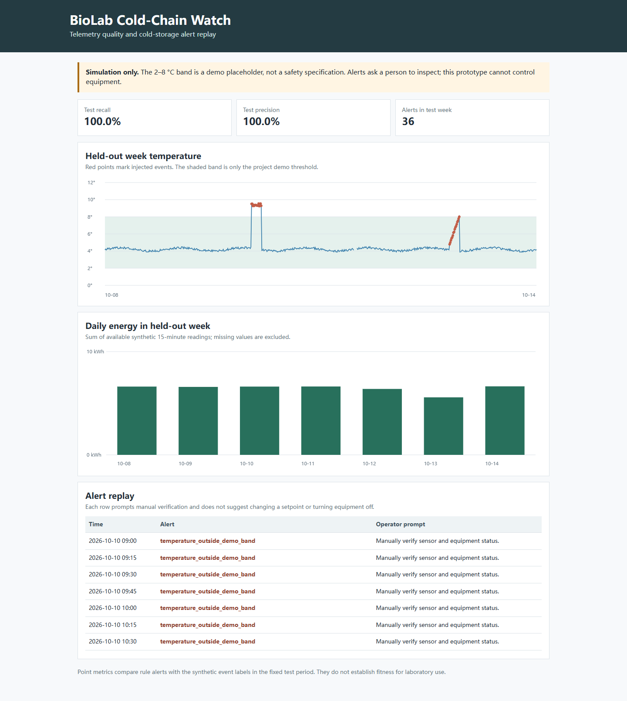

# BioLab Cold-Chain Watch

A beginner-friendly rule-based monitor for one **simulated** laboratory cold-storage device. It demonstrates how missing telemetry, a temperature excursion, or unusual energy readings can be flagged for a person to inspect.

[中文说明](README.zh-CN.md)



## Run

Requires Python 3.10 or later. No third-party packages, devices, or network access are used.

```powershell
python cold_chain_watch.py
python -m unittest discover -s tests -v
```

The script creates deterministic synthetic readings in `data/telemetry.csv`, a test summary in `results/report.json`, an alert replay in `results/alerts.csv`, and `dashboard.html`. Open the dashboard in a browser after running the script.

## Demo behavior

- Generates 14 days of 15-minute telemetry for one fictional cooler.
- Uses the first 7 days to estimate a robust energy range; evaluates the next 7 days.
- Injects labelled test events: one temperature excursion, missing telemetry, and a power interruption.
- Reports point-level precision and recall against the known synthetic labels.
- Every alert requests manual verification. The code has no equipment-control path.

## Safety and data boundary

All readings and event labels are made by this script. The 2–8 °C range is a **demo placeholder only** and is not a sample requirement, lab protocol, equipment specification, or safety threshold. Real limits depend on the material, device, SOP, manufacturer documentation, and responsible staff. This prototype cannot assess sample viability, establish compliance, or recommend a setpoint change or shutdown. The energy figures do not establish energy savings or carbon reduction.

See [`BIOLOGIST_REVIEW.md`](BIOLOGIST_REVIEW.md) for a teammate worksheet to critique the scenarios without treating them as operating instructions.

## Notes

- **Telemetry**: readings sent by a sensor or equipment monitoring system.
- **Robust range**: a reference range estimated from the median and median absolute deviation so a few extremes have less influence.
- **Precision**: share of generated alerts that match a labelled event in this demo.
- **Recall**: share of labelled demo-event intervals that were alerted.

These metrics only describe a fixed, generated scenario. They do not demonstrate laboratory suitability.
